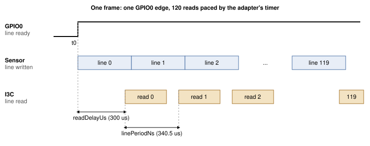

## 1 簡介

影像感測器通常透過 MIPI CSI-2 傳送像素，這需要主機具備攝影機接收器。VD55G1 也可以透過 I3C
傳送影像，而 I3C 正是用來設定它的那條雙線匯流排。如此一來，任何支援 I3C 的裝置（包括 USB 主機轉接器）
都能存取攝影機，主機端不需要任何攝影機介面。

難處在於時序。感測器在一個暫存器視窗中每次只提供一行，約 340 微秒後下一行就會取代它。在我們的
測試台上，從 PC 發出的對該視窗的 160 位元組讀取，在 200 次讀取中最快為 3.64 ms，中位數為 4.00 ms，
因此大多數行在 PC 能夠請求之前就已消失。這些讀取必須由靠近匯流排的元件發出。在本筆記中，這個角色由
Supernova 本身的韌體擔任。

### 1.1 範圍

本文件涵蓋：

- 從 PC 啟動 VD55G1：重設、列舉、修補程式下載與設定
- 啟動一個影格讀出的 GPIO0 邊緣
- Supernova 命令 `I3C_CONTROLLER_CAPTURE_LINES`，它在轉接器上讀取一個影格的每一行，並經 USB 傳回該影格
- 將靜態影格擷取為 PNG 檔案，以及每秒 9.8 影格的即時檢視
- 實測的行時序視窗

本文件不涵蓋感測器的 MIPI CSI-2 輸出、彩色感測器、高於 160x120 的解析度，以及使用帶內中斷（IBI）
而非 GPIO 來指示影格開始的感測器。

### 1.2 適用裝置

Table: 適用裝置

| 系列 | 範例元件 | 識別資訊 | 依據 |
|---|---|---|---|
| STMicroelectronics VD55G1 | Gilisymo LS-CAM-I3C 板上的 VD55G1 cut 2.0 | 暫存器 0x0000 的型號 `S5G1`，0x0004 的 cut 0x20 | 已測試 |

### 1.3 相關文件

Table: 相關文件

| 文件 | 標題 |
|---|---|
| VD55G1 資料手冊 | STMicroelectronics DS13604 |
| Gilisymo VD55G1 參考程式碼 | `https://github.com/gilisymo/vd55g1_stm32h533`，`Drivers/LS55G1/ls55g1_driver.c` 中修補程式陣列以及表 6 中暫存器寫入的來源 |
| MIPI I3C Specification | MIPI Alliance |
| Binho Supernova 文件 | `https://support.binho.io` |

## 2 系統概觀

PC 使用一般的 I3C 讀寫來啟動並設定感測器。接著，它每個影格傳送一個
`I3C_CONTROLLER_CAPTURE_LINES` 命令。Supernova 韌體獨立完成整個影格的處理，並以該影格作為回應。

Table: 分工

| 步驟 | 執行者 | 途徑 |
|---|---|---|
| 重設、列舉、修補程式下載、設定 | PC | HID 命令，pycosmicsdk |
| 開始串流、等待影格開始、將 120 行讀入 RAM | Supernova 韌體 | I3C，GPIO 輸入 |
| 傳回該影格 | Supernova 韌體 | USB 廠商批量 IN（vendor bulk IN） |
| 顯示或儲存該影格 | PC | |

決定設計的事實是：感測器的 GPIO0 設定為「行就緒」時，並不會為每一行產生脈衝。在開始串流且不讀取
任何行的情況下，它在一次 300 ms 的追蹤中只上升一次，之後一直維持高電位：

```
python capture_vd55g1.py <SERIAL> <path>/ls55g1_driver.c --trigger trace --frame-length 300
```

```
trace: result=0x0000 fsm after=ff level@0=0 transitions=1 rises=1
first 12 events (us, level): [(27675, 1)]
1/1 runs passed
```

`fsm after=ff` 是某一行未被讀取之後感測器回報的狀態；在我們的執行中，感測器離開了串流狀態並停留在該狀態。
每次執行工具時，都會在開始時重新啟動感測器。

因此，韌體將上升緣視為第 0 行的開始，並在該邊緣之後再經過 N 個行週期時讀取第 N 行。這個時間點由計時器
控制，並加上一個固定延遲，使每次讀取都發生在感測器寫入該行之後。每次擷取只需要一個邊緣：在表 14 的
工作範圍內，每個影格的全部 120 行都已傳回，且沒有任何行重複。



韌體在暫停排程器的情況下執行擷取，因此在預定時間與對應讀取之間不會執行任何其他韌體工作。一次擷取的
時間上限為 5 秒。

## 3 硬體設定

### 3.1 所需設備

Table: 所需設備

| 項目 |
|---|
| Binho Supernova USB 主機轉接器 |
| Gilisymo LS-CAM-I3C 板（VD55G1） |
| 感測器板用 3.3 V 電源 |
| 短跳線 |
| USB-C 纜線 |

### 3.2 連接

Table: Supernova 與 LS-CAM-I3C 板之間的連接

| Supernova | LS-CAM-I3C | 是否必要 |
|---|---|---|
| I3C HV 連接埠 SCL | SCL | 是 |
| I3C HV 連接埠 SDA | SDA | 是 |
| GND | GND | 是 |
| GPIO PIN_1 | NRST | 是 |
| GPIO PIN_3 | GPIO0（行就緒） | 是 |
| GPIO PIN_5 | GPIO1 | 否，本筆記未使用 |
| | VIN，3.3 V | 是，請參閱第 3.3 節 |

### 3.3 匯流排注意事項

工具將 I3C HV 連接埠與 GPIO 連接埠設定為 3300 mV。在本文件的所有量測中，VIN 皆來自一個獨立的 3.3 V
電源，該電源與 Supernova 共地。

> **注意：** 跳線要短且插接牢固。若連接在擷取過程中移動，感測器將停止回應其位址，直到再次啟動。

> **說明：** 感測器啟動期間，請勿在 GPIO0 上接著邏輯分析儀探棒；在我們的測試台上，這會使感測器無法
> 進入軟體待機狀態。

## 4 軟體設定

工具需要 pycosmicsdk（最新版本）、hidapi、pyusb 與 pillow：

```
pip install --upgrade pycosmicsdk hidapi pyusb pillow
```

即時檢視器也會使用 `tkinter`（大多數 Python 安裝都包含它），並使用 `ffmpeg` 提供選用的錄影功能。

在 Linux 上，使用者需要對 Supernova 的 USB 裝置及其 HID 介面具有讀寫權限。以下 udev 規則（與我們
測試台上安裝的相同）可授予該權限：

```
SUBSYSTEM=="hidraw", ATTRS{idVendor}=="1fc9", ATTRS{idProduct}=="82fc", MODE="0666"
SUBSYSTEM=="usb", ATTRS{idVendor}=="1fc9", ATTRS{idProduct}=="82fc", MODE="0666"
```

工具需要提供轉接器的序號。使用以下命令列出已連接的 Supernova：

```
python -c "import hid; print({d['serial_number'] for d in hid.enumerate(0x1FC9, 0x82FC)})"
```

> **說明：** 本文件中的所有程序僅在 Linux 上執行過。影格資料透過 `pyusb` 從廠商批量端點（vendor bulk
> endpoint）讀取，而在 Windows 與 macOS 上這需要 libusb 後端。這些主機尚未經過測試。

轉接器韌體必須提供 `I3C_CONTROLLER_CAPTURE_LINES`。

> **說明：** 此命令尚未包含在已發布的 Supernova 韌體中。本文件中的量測使用的是開發版本
> `4.6.1-1da26d5f`。在正式版本包含此命令之前，請聯絡 Binho 取得該版本及其燒錄說明。本文件的後續
> 修訂版將註明對應的正式版本，其安裝方式與任何 Supernova 韌體更新相同。

感測器每次上電時都需要下載修補程式。修補程式陣列屬於 STMicroelectronics，不隨本筆記重新散布。請從
表 2 中的 Gilisymo 儲存庫下載 `Drivers/LS55G1/ls55g1_driver.c`，並將其路徑傳給工具，工具會從中讀取這些陣列。

## 5 擷取命令

### 5.1 相關的 VD55G1 暫存器

表 6 列出工具使用的暫存器，其含義依 Gilisymo 參考程式碼中的寫法列出。我們尚未對照資料手冊的相應
章節核對這些含義。

Table: 工具使用的 VD55G1 暫存器

| 暫存器 | 名稱 | 用途 |
|---|---|---|
| 0x0000 | Model ID | 讀出 `S5G1`，小端序 |
| 0x001C | System FSM | 0x01 準備啟動，0x02 軟體待機，0x03 串流 |
| 0x0200 | Boot command | 0x02 套用修補程式並啟動 |
| 0x0201 | Standby command | 0x01 開始串流 |
| 0x0324 | I3C frame readout control | 0x03，開啟 I3C 影像讀出 |
| 0x0500 | Exposure mode | 0x00 自動，0x02 手動 |
| 0x050C | Frame length | 以行為單位；決定影格速率 |
| 0x051D | GPIO0 control | 0x0C，行就緒 |
| 0x2000 | Line window | 一行像素，使用 2 位元組暫存器位址讀取 |

本筆記使用的視窗從第 174 行、第 200 欄開始，大小為 160x120，RAW8 格式。

### 5.2 請求

`I3C_CONTROLLER_CAPTURE_LINES` 的命令代碼為 0x190E。請求參數緊接在命令標頭之後，採用小端序、緊密排列。

Table: 請求參數

| 偏移 | 欄位 | 大小 | 本筆記中的值 |
|---|---|---|---|
| 0 | 目標裝置動態位址 | 1 | 來自 ENTDAA |
| 1 | 暫存器位址長度 | 1 | 2 |
| 2 | 暫存器位址 | 4 | 0x20 0x00 |
| 6 | 行長度，位元組 | 2 | 160 |
| 8 | 行數 | 2 | 120 |
| 10 | 觸發模式 | 1 | 2，定時 |
| 11 | 觸發腳位 | 1 | 2，PIN_3 |
| 12 | 逾時，ms | 2 | `capture_vd55g1.py` 為 4000，`view_vd55g1.py` 為 1000；上限 5000 |
| 14 | 啟動暫存器位址長度 | 1 | 2 |
| 15 | 啟動暫存器位址 | 4 | 0x02 0x01 |
| 19 | 啟動資料長度 | 1 | 1 |
| 20 | 啟動資料 | 8 | 0x01，開始串流 |
| 28 | 讀取延遲，us | 2 | 300，最多 1000 |
| 30 | 行週期，ns | 4 | 340500 |

Table: 觸發模式

| 值 | 模式 | 第 N 行的讀取時間點 |
|---|---|---|
| 0 | GPIO 上升緣 | 觸發腳位的第 N 個上升緣，加上讀取延遲。不適用於 VD55G1，其 GPIO0 每個影格只上升一次 |
| 1 | GPIO 下降緣 | 第 N 個下降緣，加上讀取延遲。不適用於 VD55G1 |
| 2 | 定時 | 第一個上升緣加上 N 倍行週期，再加上讀取延遲 |
| 3 | 追蹤 | 從不讀取。記錄觸發腳位的每次電位轉換直到逾時，用於診斷 |

啟動寫入由韌體在等待第一個邊緣之前發出，因此在開始串流與第一行之間不會有 USB 往返。擷取必須能
放入轉接器 32768 位元組的批量暫存池：160x120、8 位元時為 19200 位元組。

### 5.3 回應

Table: 回應參數

| 偏移 | 欄位 | 大小 |
|---|---|---|
| 0 | 已擷取的行數 | 2 |
| 2 | 酬載長度，即需從廠商批量 IN 讀取的位元組數 | 4 |
| 6 | 失敗行的驅動程式錯誤，無錯誤時為 0 | 2 |
| 8 | 最小行間週期，us | 2 |
| 10 | 最大行間週期，us | 2 |
| 12 | 從某行的預定時間到其讀取完成的最長時間，us | 2 |
| 14 | 從第一行到最後一次讀取完成，us | 4 |

影格資料隨後透過廠商批量 IN 傳送。失敗之前已擷取的行也會傳回。

## 6 程序

1. 燒錄第 4 節所指定的轉接器韌體。
2. 依表 5 連接電路板，並開啟 3.3 V 電源。
3. 擷取五個影格，每個影格之前都對感測器進行一次新的重設與啟動。在 `assets/` 目錄下執行：

```
python capture_vd55g1.py <SERIAL> <path>/ls55g1_driver.c --runs 5 --out frames
```

```
run 0: result=0x0000 got 19200/19200 B in 95 ms, fsm after=03 {'lines': 120, 'bytes': 19200, 'driverError': 0, 'minPeriodUs': 340, 'maxPeriodUs': 340, 'maxReadUs': 469, 'totalUs': 40985}
run 1: result=0x0000 got 19200/19200 B in 95 ms, fsm after=03 {'lines': 120, 'bytes': 19200, 'driverError': 0, 'minPeriodUs': 340, 'maxPeriodUs': 340, 'maxReadUs': 469, 'totalUs': 40986}
run 2: result=0x0000 got 19200/19200 B in 94 ms, fsm after=03 {'lines': 120, 'bytes': 19200, 'driverError': 0, 'minPeriodUs': 340, 'maxPeriodUs': 340, 'maxReadUs': 469, 'totalUs': 40985}
run 3: result=0x0000 got 19200/19200 B in 95 ms, fsm after=03 {'lines': 120, 'bytes': 19200, 'driverError': 0, 'minPeriodUs': 340, 'maxPeriodUs': 340, 'maxReadUs': 469, 'totalUs': 40985}
run 4: result=0x0000 got 19200/19200 B in 94 ms, fsm after=03 {'lines': 120, 'bytes': 19200, 'driverError': 0, 'minPeriodUs': 340, 'maxPeriodUs': 340, 'maxReadUs': 469, 'totalUs': 40985}
5/5 runs passed
```

   每次執行都會寫入 `frames/runNN_f0.png`。啟動後的第一個影格使用尚未穩定的自動曝光，因此畫面較暗。
   若要取得靜態影像，請手動設定曝光：

```
python capture_vd55g1.py <SERIAL> <path>/ls55g1_driver.c --again 0 --exposure 60 --runs 3 --out frames
```

```
run 0: result=0x0000 got 19200/19200 B in 106 ms, fsm after=03 {'lines': 120, 'bytes': 19200, 'driverError': 0, 'minPeriodUs': 340, 'maxPeriodUs': 340, 'maxReadUs': 469, 'totalUs': 40984}
run 1: result=0x0000 got 19200/19200 B in 107 ms, fsm after=03 {'lines': 120, 'bytes': 19200, 'driverError': 0, 'minPeriodUs': 340, 'maxPeriodUs': 340, 'maxReadUs': 469, 'totalUs': 40985}
run 2: result=0x0000 got 19200/19200 B in 107 ms, fsm after=03 {'lines': 120, 'bytes': 19200, 'driverError': 0, 'minPeriodUs': 340, 'maxPeriodUs': 340, 'maxReadUs': 469, 'totalUs': 40985}
3/3 runs passed
```


4. 開始即時檢視。它先啟動感測器一次，然後在自動曝光下連續擷取影格。關閉視窗或按 Ctrl+C 停止；它會
   印出一份摘要：

```
python view_vd55g1.py <SERIAL> <path>/ls55g1_driver.c
```

```
590 frames ok, 0 bad, 0 reboots in 60.2 s (9.8 fps)
```

   加上 `--record out.mp4` 可將串流儲存為影片。

## 7 參考

Table: capture_vd55g1.py 選項

| 選項 | 預設值 | 含義 |
|---|---|---|
| `--runs N` | 1 | 重設、啟動並擷取 N 次；印出通過比例 |
| `--out DIR` | `frames` | PNG 檔案的寫入位置 |
| `--trigger` | `gpio-timed` | `gpio-timed`，或使用 `trace` 印出 GPIO0 的電位轉換而不進行擷取。`gpio` 與 `gpio-falling` 列於表 8，不適用於 VD55G1 |
| `--line-period-ns` | 340500 | 定時觸發的行週期 |
| `--post-delay-us` | 300 | 每行預定時間之後的讀取延遲，0 至 1000 |
| `--again CODE` | 自動曝光 | 使用此類比增益代碼進行手動曝光，0 至 28 |
| `--exposure LINES` | 500 | 曝光時間（以行為單位），僅限手動模式 |
| `--dgain` | 1.1 | 數位增益 |
| `--frame-length LINES` | 700 | 感測器影格長度 |
| `--frames N` | 1 | 一次擷取中的連續影格數，不超出暫存池 |
| `--width`, `--height` | 160, 120 | 視窗大小 |

Table: view_vd55g1.py 選項

| 選項 | 預設值 | 含義 |
|---|---|---|
| `--frame-length LINES` | 300 | 感測器影格長度；決定影格速率（表 13） |
| `--again CODE` | 自動曝光 | 使用此類比增益代碼進行手動曝光 |
| `--exposure LINES` | 60 | 曝光時間（以行為單位），僅與 `--again` 一起使用 |
| `--dgain` | 1.1 | 數位增益 |
| `--scale N` | 4 | 視窗放大倍數 |
| `--record FILE` | 無 | 同時使用 ffmpeg 將影格寫入影片檔，標記為 10 fps |
| `--width`, `--height` | 160, 120 | 視窗大小 |
| `--line-period-ns`, `--post-delay-us` | 340500, 300 | 與 `capture_vd55g1.py` 相同 |

檢視器在連續三次擷取失敗後會重新啟動感測器。

## 8 量測結果

### 8.1 測試配置

Table: 測試配置

| 項目 | 版本 |
|---|---|
| 轉接器 | Binho Supernova，韌體 `4.6.1-1da26d5f`（開發版本） |
| 感測器 | Gilisymo LS-CAM-I3C 板上的 VD55G1 cut 2.0，VIN 3.3 V 來自獨立電源 |
| 匯流排 | I3C SDR，10 MHz 推挽，40 % 工作週期，3300 mV |
| 主機 | Linux 7.2.5，Python 3.14.7，pycosmicsdk 1.6.0，hidapi 0.15.0，pyusb 1.3.1，pillow 12.3.0 |
| 視窗 | 160x120 RAW8，起始於第 174 行、第 200 欄 |

### 8.2 影格速率

影格速率由感測器的影格長度（以行為單位）乘以行週期決定。表 13 的每一列對應一次約 32 秒的
`view_vd55g1.py --frame-length N` 執行。

Table: 影格速率與影格長度的關係

| 影格長度，行 | 成功影格數 | 擷取失敗數 | 感測器重新啟動次數 | 影格速率，fps |
|---|---|---|---|---|
| 700 | 136 | 0 | 0 | 4.2 |
| 400 | 238 | 0 | 0 | 7.4 |
| 300 | 317 | 0 | 0 | 9.8 |
| 280 | 339 | 0 | 0 | 10.5 |
| 260 | 66 | 15 | 5 | 1.9 |

在 260 行時擷取失敗，感測器必須重新啟動。在此視窗下，讀出於第 294 行（174 加 120）結束；我們尚未
確定這是否為原因。300 行是檢視器的預設值。

### 8.3 行週期與讀取延遲

若讀取在感測器寫入該行之前到達，感測器將停止回應其位址（結果 0x060B），直到再次啟動；表 14 將這種
情況稱為「感測器遺失」。若讀取到達過晚，則會傳回重複的行，或擷取以結果 0x0009（「late」）失敗。
表 14 統計每個量測點五次擷取中的這兩種情況，影格長度為 300，使用手動曝光
（`--again 0 --exposure 60`），每次失敗後都重新啟動感測器。重複行的統計方式是將影格中的每一行與前一行
進行比較，所用腳本以 `capture_vd55g1.py` 的 `capture()` 函式為基礎撰寫。

Table: 5 次擷取中重複行為 0 的次數與行週期的關係

| 行週期，us | 讀取延遲 300 us | 讀取延遲 250 us |
|---|---|---|
| 336.8 | 0，感測器遺失 5/5 | 0，感測器遺失 5/5 |
| 337.7 | 0，感測器遺失 5/5 | 0，感測器遺失 5/5 |
| 338.5 | 2，感測器遺失 3/5 | 未量測 |
| 339.0 | 5 | 未量測 |
| 340.5 | 5 | 5 |
| 343.0 | 5 | 未量測 |
| 345.0 | 5 | 5 |
| 347.0 | 5 | 未量測 |
| 348.0 | 1，late 4/5 | 1，late 4/5 |

在 300 us 延遲下，可用範圍為 339.0 至 347.0 us。預設值 340.5 us 比其下限高 1.5 us；在 120 行中，
這個差值會使最後一次讀取移動 180 us。

在檢視器預設的自動曝光下進行相同的掃描，在 339.0、339.5、343.0、345.0 與 347.0 us 時，5 次擷取中
有 5 次重複行為 0；在 338.5 與 340.5 us 時為 5 次中的 4 次，其中有一次擷取遺失了感測器。鬆動的連接
也會產生相同的結果代碼，因此我們不將這兩次失敗歸因於行週期。

### 8.4 持續擷取

在相同接線上進行了四次 60 秒的檢視器執行，交替使用不同的行週期，每次擷取 439 至 591 個影格。

Table: 持續擷取，每次執行 60 秒

| 行週期，us | 成功影格數 | 擷取失敗數 | 感測器重新啟動次數 | 影格速率，fps |
|---|---|---|---|---|
| 340.5 | 439 | 18 | 6 | 7.3 |
| 343.0 | 460 | 12 | 4 | 7.6 |
| 340.5 | 591 | 0 | 0 | 9.8 |
| 343.0 | 537 | 3 | 1 | 8.9 |

失敗與行週期無關。影格速率一欄只計算成功的影格，因此有失敗的執行所回報的影格速率低於 9.8。

## 9 疑難排解

Table: 疑難排解

| 症狀 | 可能原因與處理方式 |
|---|---|
| `result=0x060B`，且之後的讀取也失敗 | 感測器停止回應其位址。重新插好跳線，然後再次執行；工具會在開始時啟動感測器 |
| `not SW_STBY after boot` | 啟動期間 GPIO0 上接著探棒，或連接鬆動。移除探棒並重新插好 |
| `not a VD55G1 cut 2.0` | 感測器型號或 cut 不同，或沒有感測器回應。檢查 VIN 與 I3C 連線 |
| 影格長度較短時擷取失敗 | 在此視窗下 260 行失敗；280 行及以上正常（表 13） |
| 每次擷取都逾時 | GPIO0 未連接到 PIN_3 |
| 第一個影格較暗 | 自動曝光尚未穩定。使用檢視器，或使用 `--again 0 --exposure 60` |
| `result=0x0004` | 參數超出範圍。已測試：觸發模式大於 3、讀取延遲大於 1000、定時模式下行週期為 0、觸發腳位未設定為輸入、未知腳位。依據韌體原始碼，未測試：行長度或行數為 0、暫存器位址長於 4 位元組、啟動資料長於 8 位元組 |
| `result=0x0003` | 依據韌體原始碼，未測試：擷取無法放入暫存池，或暫存池正在使用中 |

## 10 縮寫

Table: 縮寫

| 術語 | 含義 |
|---|---|
| CSI-2 | Camera Serial Interface 2，MIPI Alliance 的一項規範 |
| ENTDAA | Enter Dynamic Address Assignment，一種 I3C 通用命令 |
| FSM | 有限狀態機（Finite state machine） |
| I3C | MIPI I3C，一種改良的內部積體電路匯流排 |
| RAW8 | 未經處理的像素資料，每像素 8 位元 |
| SDR | 單倍資料速率（Single data rate），I3C 的基本傳輸模式 |

## 11 關於文件中原始碼的說明

本文件中展示以及隨附封存檔中提供的範例程式碼僅供評估與參考。這些程式碼依 MIT 授權條款發布，授權條款
全文包含在封存檔中。

封存檔 `AN0017-assets.zip` 包含 `capture_vd55g1.py`（啟動、設定、擷取為 PNG，以及 GPIO0 追蹤）、
`view_vd55g1.py`（即時檢視與錄影）、`raw_link.py`（擷取命令所用的 HID 與廠商批量傳輸層）以及
`LICENSE`。它不包含感測器修補程式；請參閱第 4 節。

## 12 修訂歷史

Table: 修訂歷史

| 修訂版 | 日期 | 說明 |
|---|---|---|
| 0.1 | 14 October 2026 | 供內部審閱的草稿。在開發版韌體上量測。 |
| 1.0 | 6 November 2026 | 正式發布。 |
